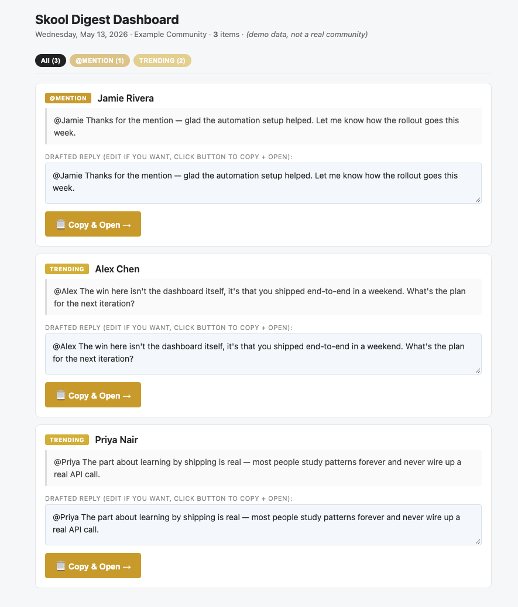

# Skool Community Daily Digest


Email digest of new posts, comments, and replies in the **AI Automation Society Plus** Skool community, with AI-drafted replies pre-written for copy-paste.

Runs daily 7am ET on GitHub Actions. No scraping — uses your own Gmail.

## How it works

```
Skool notifications  →  Gmail "Skool" label  →  GitHub Action (daily 11:00 UTC)
                                                        ↓
                            Gmail API ─▶ HTML parser ─▶ Claude Haiku 4.5 ─▶ SendGrid ─▶ your inbox
```

Nothing posts back to Skool. You open the thread link and paste the reply.



*Demo data shown above — not a real community.*

## One-time setup

### 1. Turn on Skool email notifications

In Skool → Settings → Notifications, enable email for:
- New posts in the community
- Comments on your posts
- Replies to your comments
- @mentions

Leave **DMs off** — those are private and intentionally skipped.

### 2. Create a Gmail filter

In Gmail → Settings → Filters and Blocked Addresses → Create a new filter:

- **From:** `notifications@skool.com OR noreply@skool.com OR community@skool.com`
- **Actions:** Apply the label `Skool`. (Optional: also "Skip the Inbox" if you want them auto-archived.)

The agent queries `label:Skool newer_than:1d`. Anything in that label from the last 24h gets processed.

### 3. Mint a Gmail OAuth token

1. Google Cloud Console → create or pick a project → enable the **Gmail API**.
2. APIs & Services → Credentials → Create Credentials → **OAuth client ID** → Desktop app.
3. Download the JSON → save as `agents/skool-digest/credentials.json` (gitignored).
4. From the agent dir, run the one-time auth flow:

```bash
cd agents/skool-digest
/opt/homebrew/bin/python3.13 -m venv .venv
source .venv/bin/activate
pip install -r requirements.txt
python -m skool_digest.gmail_fetch --auth
```

A browser opens; sign in to the Gmail account that receives Skool notifications. After approval, `token.json` is written.

5. Base64 it for GitHub Actions:

```bash
base64 -i token.json | pbcopy
```

### 4. GitHub repo secrets

Push this folder to GitHub (e.g. `maldonador8/skool-digest`), then set repo secrets:

| Secret | Value |
|---|---|
| `ANTHROPIC_API_KEY` | from your `.env` |
| `SENDGRID_API_KEY` | from your `.env` |
| `GMAIL_TOKEN_B64` | the clipboard contents from step 3.5 |
| `DIGEST_RECIPIENT` | the email address that should receive the digest |
| `FROM_EMAIL` | a verified SendGrid sender |
| `FROM_NAME` | `Skool Digest` |

### 5. First run

Trigger manually to confirm everything's wired:

```bash
gh workflow run skool_digest_daily.yml
gh run watch
```

Then check your inbox.

## Local usage

```bash
# Full live run (pulls Gmail, drafts replies, sends email)
python -m skool_digest.main

# Print HTML to stdout, don't send
python -m skool_digest.main --dry-run

# Don't call Anthropic (fast parser-only debugging)
python -m skool_digest.main --dry-run --no-ai

# Test against .eml fixtures saved in tests/fixtures/
python -m skool_digest.main --dry-run --from-fixtures tests/fixtures/
```

## Tuning the voice

The reply tone lives in `skool_digest/ai_drafter.py` → `SYSTEM_PROMPT`. After a few mornings, you'll know what to tighten. Common edits:
- Make replies shorter / longer (adjust word cap and `max_tokens`)
- Add domain-specific guardrails (e.g. "never recommend specific paid tools")
- Bias toward questions when the original post is vague

## Costs

- **Anthropic:** ~$0.03/day (Haiku 4.5, <50 items/day @ ~600 tokens each).
- **SendGrid:** free tier (100 sends/day; we use 1).
- **GitHub Actions:** free tier (this job ≈ 2 minutes/day).
- **Gmail API:** free.

Total: pennies per month.

## Files

| File | Purpose |
|---|---|
| `skool_digest/main.py` | CLI entrypoint, `--dry-run` / `--from-fixtures` flags |
| `skool_digest/gmail_fetch.py` | Gmail API client + one-time auth flow |
| `skool_digest/email_parser.py` | Skool email HTML → structured items |
| `skool_digest/ai_drafter.py` | Claude Haiku 4.5 reply generation |
| `skool_digest/digest_builder.py` | HTML rendering + SendGrid send |
| `.github/workflows/skool_digest_daily.yml` | Daily cron |
| `tests/fixtures/` | Drop sanitized `.eml` files here for offline testing |

See [../../workflows/skool_community_digest.md](../../workflows/skool_community_digest.md) for the WAT-style SOP.
